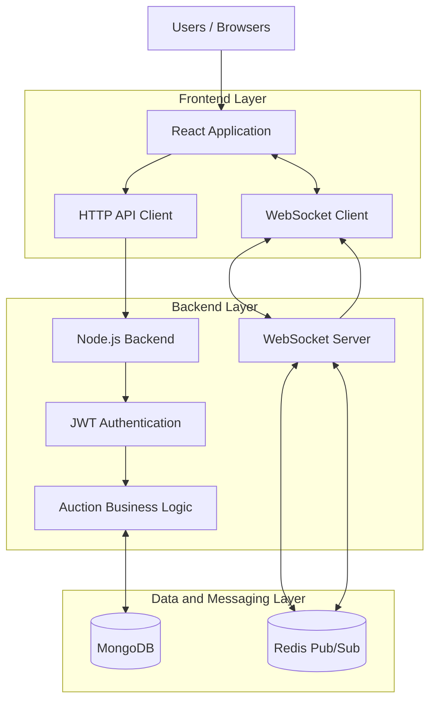
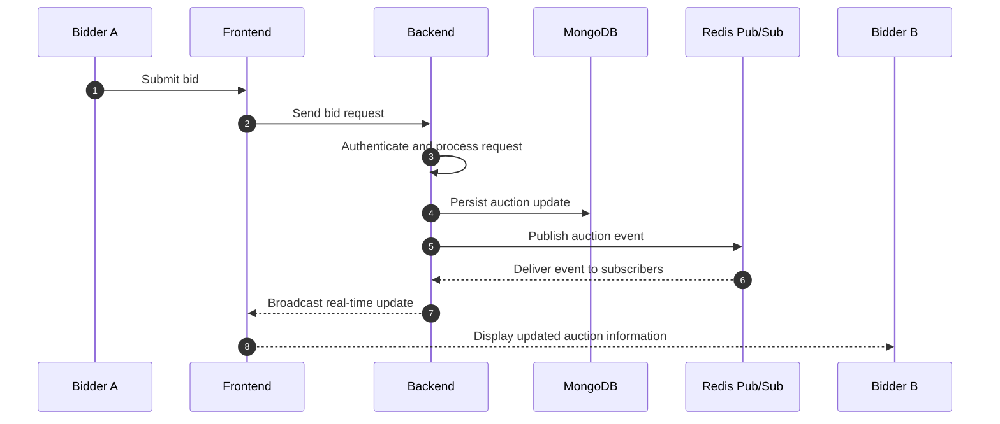

# ⚡ Real-Time Auction Platform

<p align="center">
  <strong>A full-stack auction application with live bidding, real-time event communication, and distributed messaging.</strong>
</p>

<p align="center">
  <a href="https://auction-app-six-plum.vercel.app/">Live Demo</a> •
  <a href="https://github.com/anand21314/auction-app">Source Code</a>
</p>

---

## 🚀 About the Project

The **Real-Time Auction Platform** is a full-stack web application built to provide an interactive online auction experience.

Unlike traditional auction interfaces that require users to refresh pages to see updates, this application uses real-time communication to deliver auction activity to connected participants.

The system combines a JavaScript frontend, Node.js backend, MongoDB persistence, JWT-based authentication, WebSocket communication, and Redis Pub/Sub to support a responsive bidding experience.

The project focuses on solving practical full-stack engineering challenges:

- Maintaining synchronized auction information across connected clients.
- Handling real-time communication between the frontend and backend.
- Managing authenticated application operations.
- Coordinating event-driven updates through backend messaging.
- Separating frontend presentation from backend business logic.

<blockquote>
  **Project focus:** Full-stack development, real-time systems, event-driven architecture, API integration, and backend communication.
</blockquote>

## 🌐 Live Application

<badge color="success">Live demo</badge>

**[Launch the Real-Time Auction Platform](https://auction-app-six-plum.vercel.app/)**

> Add screenshots or a short demonstration video here to help visitors understand the actual interface without needing to register or explore the application first.

## ✨ Core Capabilities

### 1. Auction Management
- Explore auction listings.
- View auction-related information.
- Interact with auction functionality through the web interface.
- Participate in the bidding experience.

### 2. Real-Time Bidding

Real-time communication is a central part of the application.

- WebSocket-based communication.
- Live auction event delivery.
- Updates propagated to connected participants.
- Reduced dependence on manual page refreshes.

### 3. Authentication

- JWT-based authentication.
- Token-based handling of authenticated requests.
- Backend-controlled access to protected operations.

### 4. Event-Driven Backend Communication

- Redis Pub/Sub for messaging between backend components.
- Real-time event propagation.
- Separation of HTTP request handling and real-time communication.

### 5. Full-Stack Integration

- Dedicated frontend and backend applications.
- API-driven communication.
- MongoDB integration.
- Environment-based frontend API configuration.
- Production and preview domain CORS configuration.

---

## 🏗️ System Architecture

The application separates the user interface, backend application logic, persistent data, and real-time messaging responsibilities.



*Architecture diagram illustrates the project's technology responsibilities. Confirm the exact runtime connections and deployment topology against the source code.*

### Architecture Responsibilities

| Layer | Responsibility |
|---|---|
| React frontend | User interaction and application interface |
| HTTP API | Client-server request communication |
| Node.js backend | Application logic and request handling |
| JWT | Authentication and protected access |
| MongoDB | Persistent application data |
| WebSockets | Bidirectional real-time communication |
| Redis Pub/Sub | Message distribution between backend components |

---

## 🔄 How Real-Time Bidding Works

The real-time bidding experience follows an event-driven communication model.



*This sequence is a conceptual representation; adjust the exact event order to match your implementation.*

### Why Use WebSockets?

Traditional HTTP communication follows a request-response pattern. WebSockets allow a persistent, bidirectional connection between clients and the server.

This is useful for an auction application because participants need timely updates about auction activity.

### Why Use Redis Pub/Sub?

Redis Pub/Sub provides a messaging mechanism for distributing events between subscribers.

In a multi-process or multi-instance backend architecture, this can help coordinate real-time event delivery beyond a single server process.

---

## 🧰 Technology Stack

| Category | Technology |
|---|---|
| Frontend | React, JavaScript, HTML, CSS |
| Backend | Node.js, Express.js |
| Database | MongoDB |
| Authentication | JSON Web Tokens |
| Real-Time Communication | WebSockets / Socket.IO |
| Messaging | Redis Pub/Sub |
| Frontend Deployment | Vercel |
| Version Control | Git and GitHub |

*Confirm exact package names and versions in the frontend and backend package manifests.*

## 📁 Project Structure

```text
auction-app/
│
├── frontend/
│   ├── public/
│   ├── src/
│   │   ├── components/
│   │   ├── pages/
│   │   ├── services/
│   │   └── ...
│   ├── package.json
│   └── ...
│
├── backend/
│   ├── routes/
│   ├── controllers/
│   ├── models/
│   ├── middleware/
│   ├── ...
│   └── package.json
│
├── .gitignore
└── README.md
```

*Illustrative structure. Replace the example subdirectories with the actual directory tree from the repository.*

---

## ⚙️ Local Development Setup

### Prerequisites

Install the following before running the application:

- Node.js
- npm
- MongoDB
- Redis, if required by the backend configuration
- Git

### 1. Clone the Repository

```bash
git clone https://github.com/anand21314/auction-app.git

cd auction-app
```

### 2. Configure the Backend

```bash
cd backend
npm install
```

Create the backend environment file using the variable names expected by the backend code.

Example configuration template:

```env
PORT=your_backend_port
MONGO_URI=your_mongodb_connection_string
JWT_SECRET=your_jwt_secret
REDIS_URL=your_redis_connection_string
```

### 3. Start the Backend

Use the development script defined in `backend/package.json`.

```bash
npm run dev
```

### 4. Configure the Frontend

Open another terminal:

```bash
cd frontend
npm install
```

Create the appropriate frontend environment file:

```env
VITE_API_URL=http://localhost:YOUR_BACKEND_PORT
```

### 5. Start the Frontend

```bash
npm run dev
```

Open the local development URL displayed in the terminal.

> **Configuration note:** The environment variable examples above are templates, not a verified list of the project's actual variable names. Check the source code and package scripts before publishing these instructions.

---

## 🔐 Security and Reliability Considerations

The application uses JWT-based authentication and backend-controlled operations.

Important areas to consider when developing and extending a real-time auction system include:

| Area | Engineering consideration |
|---|---|
| Authentication | Verify tokens on protected operations |
| Authorization | Validate whether a user can perform an action |
| Bid validation | Validate bid amounts on the server |
| Data consistency | Prevent invalid or conflicting bid updates |
| Real-time events | Validate event payloads and subscriptions |
| Secrets | Keep API keys and credentials outside source control |
| CORS | Restrict allowed origins to trusted frontend domains |

These are important design considerations, not claims that every safeguard is already implemented.

## 🧠 Engineering Challenges and Design Considerations

A real-time auction application introduces several interesting engineering problems.

**Real-time synchronization**

Multiple users may be viewing the same auction simultaneously. The backend needs to distribute relevant changes to connected clients.

**Concurrent bidding**

Multiple users may submit bids close together. The backend should validate and persist bids safely so that conflicting updates do not corrupt auction state.

**Authentication across communication channels**

HTTP requests and WebSocket connections have different communication lifecycles. Authentication and authorization need to be handled appropriately for each channel.

**Distributed event delivery**

When backend components operate independently, Redis Pub/Sub can provide a mechanism to distribute events between subscribers.

## 📸 Application Screenshots

Add actual screenshots from the running application here.

| Application View | Screenshot |
|---|---|
| Main auction interface | `docs/screenshots/home.png` |
| Auction details | `docs/screenshots/auction-details.png` |
| Bidding experience | `docs/screenshots/live-bidding.png` |
| User interface | `docs/screenshots/dashboard.png` |

Create the screenshots folder and replace these paths with real screenshots before publishing.

## 🧪 Testing and Quality

Recommended areas for testing and validation:

- Authentication and authorization.
- Valid and invalid bid submissions.
- Real-time event delivery.
- Multiple clients connected to the same auction.
- Database persistence.
- Backend error handling.
- Frontend API configuration.
- Production CORS behavior.

Only mark tests as completed once they exist and pass in the repository.

## 🚀 Future Roadmap

Potential improvements:

- [ ] Automated backend unit and integration tests.
- [ ] Automated frontend tests.
- [ ] Stronger concurrent bidding safeguards.
- [ ] Auction history and activity timeline.
- [ ] Real-time user notifications.
- [ ] API documentation.
- [ ] Structured application logging.
- [ ] Load testing for concurrent participants.
- [ ] Improved mobile experience.
- [ ] Accessibility improvements.

## 💡 What This Project Demonstrates

This project brings together several practical software engineering concepts:

- Designing and integrating a full-stack application.
- Building and consuming backend APIs.
- Implementing token-based authentication.
- Working with persistent database storage.
- Building real-time client-server communication.
- Using Redis Pub/Sub for event distribution.
- Managing frontend and backend environments.
- Configuring production frontend connectivity.

## 👨‍💻 Author

**Anand**

- GitHub: [@anand2257](https://github.com/anand2257)
- Project Repository: [auction-app](https://github.com/anand21314/auction-app)
- Live Application: [Auction Platform](https://auction-app-six-plum.vercel.app/)

---

<p align="center">
  <strong>Built with JavaScript, real-time communication, and full-stack engineering.</strong>
</p>
